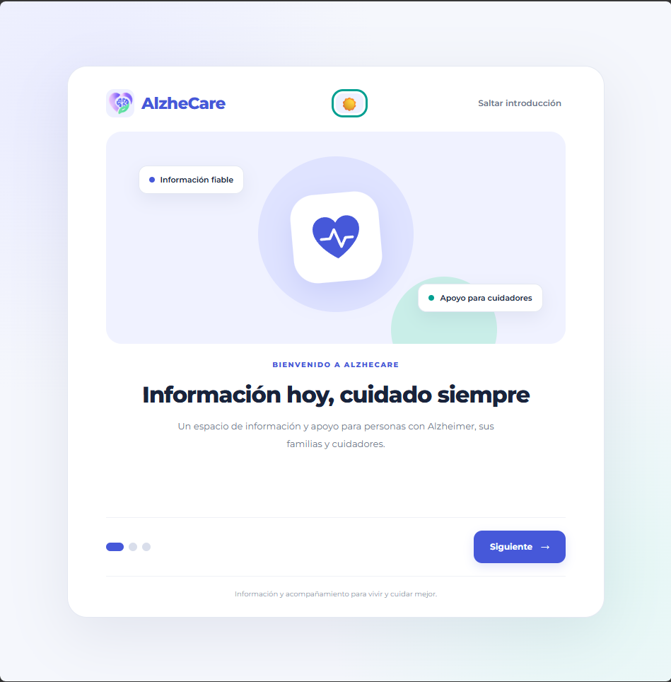
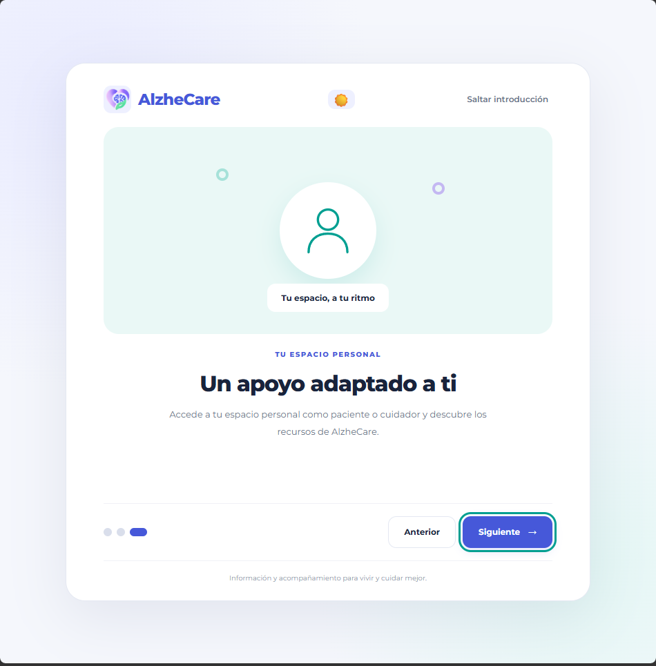
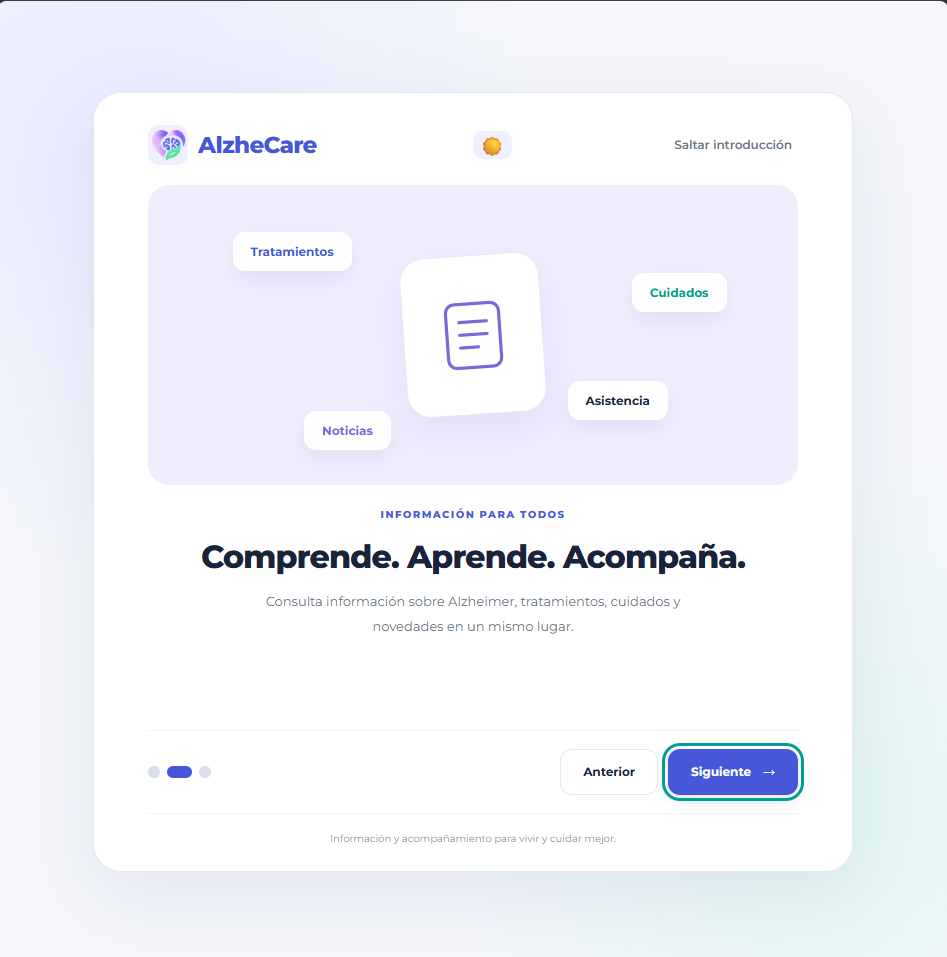
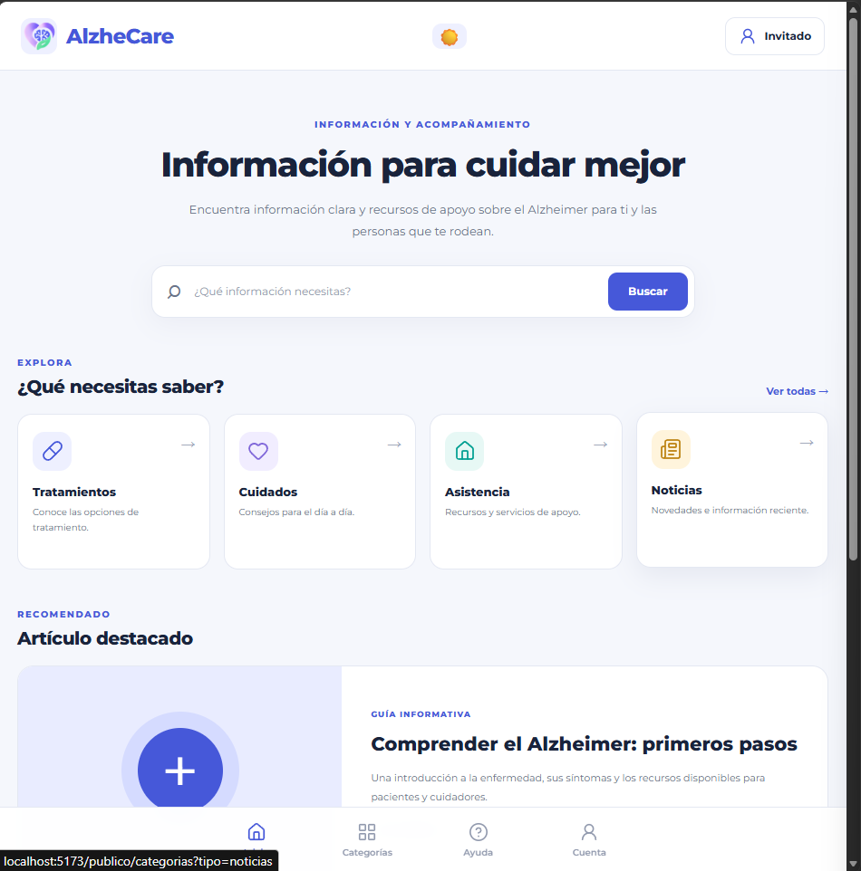
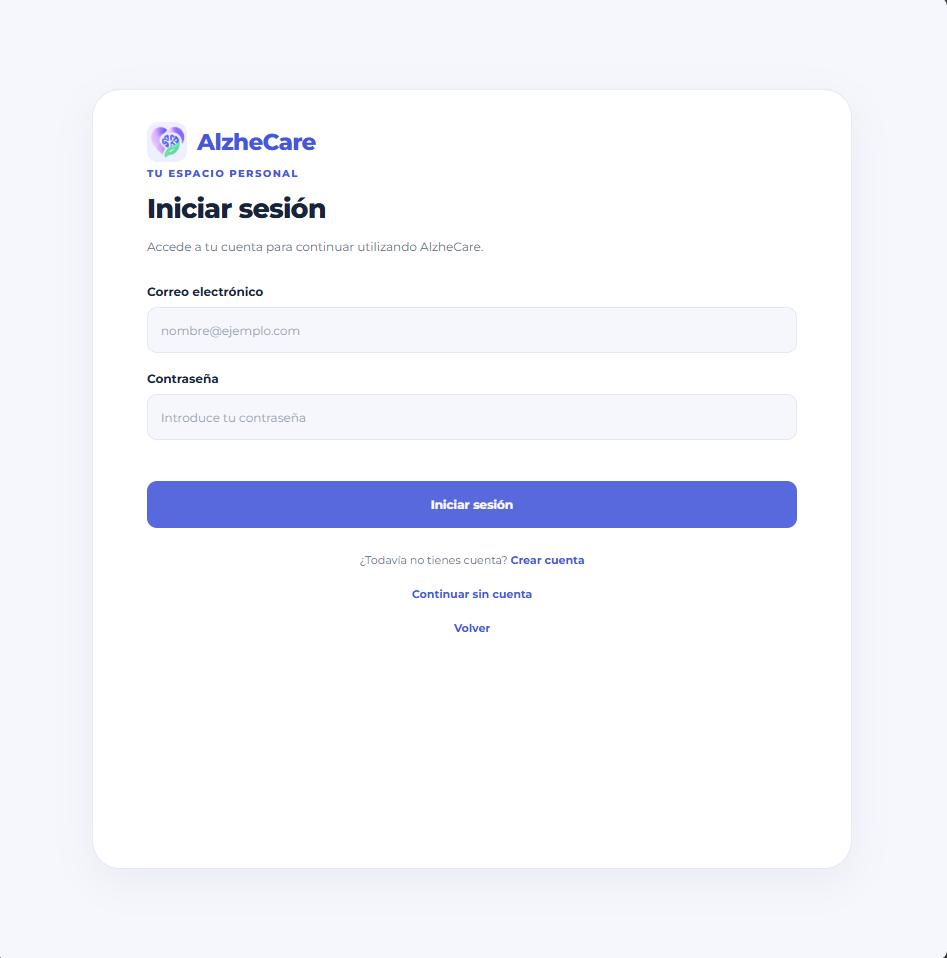
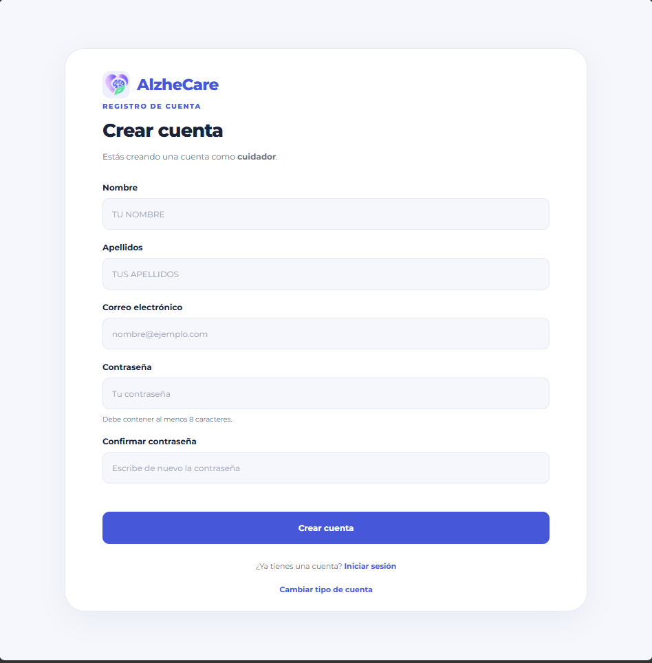
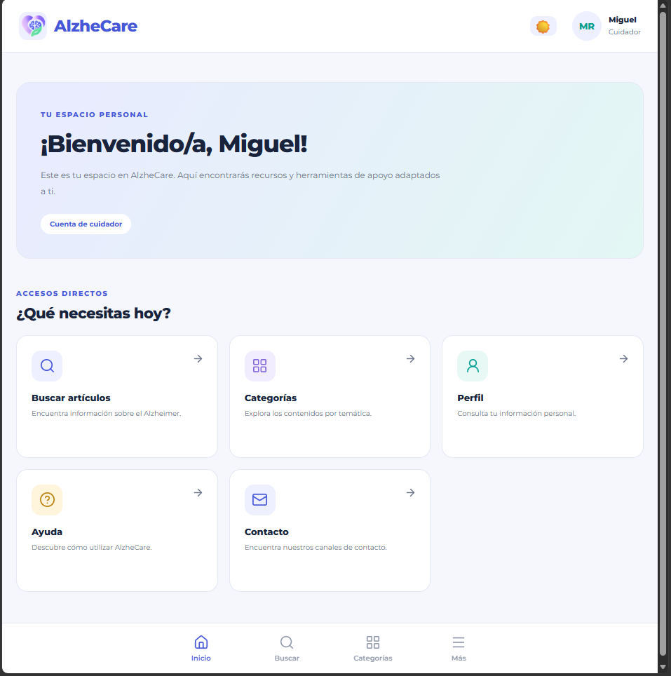

# AlzheCare – Segunda entrega: Autenticación y Áreas de Usuario

Aplicación orientada a proporcionar información y asistencia a personas con Alzheimer, sus familiares y cuidadores.

Esta segunda entrega amplía la estructura inicial de AlzheCare mediante la incorporación del sistema de autenticación, la gestión de usuarios y roles, la conexión entre el frontend y el backend, y la diferenciación entre el área pública y el área privada de la aplicación.

---

## Table of Contents

1. [Información general](#información-general)
2. [Funcionalidades implementadas](#funcionalidades-implementadas)
3. [Tecnologías utilizadas](#tecnologías-utilizadas)
4. [Instalación y ejecución](#instalación-y-ejecución)
5. [Usabilidad y diseño](#usabilidad-y-diseño)
   - [Usabilidad actual](#usabilidad-actual)
   - [Accesibilidad](#accesibilidad)
   - [Aspecto visual](#aspecto-visual)
6. [Arquitectura y navegación](#arquitectura-y-navegación)
7. [Autenticación y gestión de usuarios](#autenticación-y-gestión-de-usuarios)
8. [Prototipado](#prototipado)
9. [Ejecutando las pruebas](#ejecutando-las-pruebas)
10. [Estado del proyecto y próximas entregas](#estado-del-proyecto-y-próximas-entregas)
11. [Desarrollo](#desarrollo)

---

## 1. Información general

AlzheCare es un proyecto de aplicación móvil diseñado para facilitar el acceso a información sobre la enfermedad de Alzheimer y ofrecer un espacio de apoyo a pacientes, familiares y cuidadores.

La aplicación se divide en dos áreas principales:

- **Área pública:** permite consultar información relacionada con el Alzheimer, sus cuidados, tratamientos, asistencia y noticias, sin necesidad de registrarse.
- **Área personal:** ofrece funcionalidades privadas para usuarios registrados, diferenciando entre pacientes y cuidadores mediante un sistema de roles.

### Segunda entrega: Autenticación y Áreas de Usuario

En esta fase se ha ampliado el desarrollo inicial, incorporando tanto funcionalidades del frontend como la infraestructura necesaria para gestionar usuarios y autenticar sus sesiones.

Los objetivos principales han sido:

- Completar la estructura de navegación pública y privada.
- Desarrollar las pantallas de inicio de sesión y registro.
- Incorporar la selección del tipo de usuario durante el registro.
- Implementar un sistema de autenticación mediante JWT.
- Desarrollar el backend utilizando Spring Boot.
- Configurar la conexión con la base de datos MariaDB.
- Gestionar los roles de paciente y cuidador.
- Proteger las rutas privadas de la aplicación.
- Incorporar un sistema de temas claro y oscuro.
- Preparar la arquitectura para ampliar las funcionalidades en próximas entregas.

**Estado del proyecto:** En desarrollo. La segunda entrega incorpora la autenticación funcional y establece la estructura de las áreas pública y privada.

---

## 2. Funcionalidades implementadas

En esta segunda entrega se han incorporado las siguientes funcionalidades:

### Área pública

- **Página de bienvenida:** pantalla inicial desde la que se puede acceder al área informativa, iniciar sesión o registrarse.
- **Inicio público:** página principal con información introductoria sobre AlzheCare, categorías, buscador visual, artículos destacados y noticias.
- **Navegación pública:** menú inferior para acceder a las principales secciones informativas.
- **Estructura de categorías:** organización inicial de los contenidos en tratamientos, cuidados, asistencia y noticias.
- **Secciones preparadas:** estructura de rutas para futuras funcionalidades como búsqueda, resultados, artículos y ayuda.

### Autenticación y registro

- **Inicio de sesión:** formulario conectado con el backend para autenticar usuarios registrados.
- **Registro de usuarios:** formulario dividido en dos pasos, comenzando por la selección del tipo de usuario.
- **Selección de rol:** posibilidad de registrarse como paciente o cuidador.
- **Autenticación mediante JWT:** generación y validación de tokens para gestionar las sesiones.
- **Contraseñas protegidas:** almacenamiento de contraseñas mediante BCrypt.
- **Restauración de sesión:** comprobación de la sesión al iniciar la aplicación.
- **Cierre de sesión:** posibilidad de cerrar la sesión desde el apartado de opciones, solicitando confirmación antes de realizar la acción.

### Área privada

- **Inicio privado:** página principal para usuarios autenticados, con un mensaje personalizado y accesos directos a las principales secciones.
- **Identificación del usuario:** visualización del nombre y del rol correspondiente.
- **Navegación privada:** menú inferior con accesos a inicio, búsqueda, categorías y más opciones.
- **Apartado Más:** acceso a las opciones de perfil, ayuda, contacto y cierre de sesión.
- **Protección de rutas:** las páginas privadas requieren una sesión autenticada y un rol autorizado.

Actualmente, pacientes y cuidadores comparten la misma estructura de navegación y la misma página de inicio privada. La diferenciación de contenidos y herramientas específicas para cada perfil se abordará en futuras fases.

### Apariencia y personalización

- **Modo claro y oscuro:** posibilidad de cambiar entre ambos temas.
- **Preferencia de tema:** conservación de la selección del usuario entre sesiones.
- **Logotipo adaptable:** utilización de diferentes versiones del logotipo según el tema seleccionado.
- **Componentes reutilizables:** organización de elementos comunes para mantener la coherencia visual.

Algunas secciones ya cuentan con su estructura de navegación, pero todavía muestran contenido provisional mientras se desarrollan sus funcionalidades definitivas.

---

## 3. Tecnologías utilizadas

Las principales tecnologías y herramientas utilizadas en esta entrega son:

### Frontend

- **[React](https://react.dev/)** – Biblioteca JavaScript utilizada para construir la interfaz de usuario mediante componentes.
- **[Vite](https://vite.dev/)** – Herramienta de desarrollo y construcción del frontend.
- **[React Router](https://reactrouter.com/)** – Biblioteca utilizada para gestionar las rutas y la navegación entre las diferentes páginas.
- **[JavaScript](https://developer.mozilla.org/es/docs/Web/JavaScript)** – Lenguaje utilizado para implementar la lógica de los componentes y la comunicación con el backend.
- **[CSS](https://developer.mozilla.org/es/docs/Web/CSS)** – Utilizado para definir los estilos, la distribución de los elementos y los temas visuales.
- **[Lucide React](https://lucide.dev/)** – Biblioteca de iconos utilizada en los diferentes componentes de la interfaz.
- **Context API** – Utilizada para gestionar estados globales como la autenticación, el tema visual y otros datos compartidos.

### Backend

- **[Java 21](https://www.oracle.com/java/)** – Lenguaje utilizado para desarrollar la lógica del servidor.
- **[Spring Boot](https://spring.io/projects/spring-boot)** – Framework utilizado para construir la API REST.
- **[Spring Security](https://spring.io/projects/spring-security)** – Encargado de gestionar la seguridad y proteger los recursos del backend.
- **[Spring Data JPA](https://spring.io/projects/spring-data-jpa)** – Facilita el acceso y la persistencia de datos.
- **[Hibernate](https://hibernate.org/)** – Framework ORM utilizado para la comunicación entre Java y la base de datos.
- **JWT (JSON Web Token)** – Sistema utilizado para gestionar la autenticación mediante tokens.
- **BCrypt** – Algoritmo utilizado para proteger las contraseñas de los usuarios.

### Base de datos y herramientas

- **[MariaDB](https://mariadb.org/)** – Sistema gestor de bases de datos relacional utilizado para almacenar la información.
- **[Node.js](https://nodejs.org/)** – Entorno necesario para ejecutar las herramientas de desarrollo del frontend.
- **[npm](https://www.npmjs.com/)** – Gestor de paquetes utilizado para instalar las dependencias.
- **[Maven](https://maven.apache.org/)** – Herramienta utilizada para gestionar las dependencias y la construcción del backend.
- **[Git](https://git-scm.com/)** – Sistema de control de versiones del proyecto.
- **Visual Studio Code** – Editor utilizado durante el desarrollo.

*Nota: las versiones concretas de las dependencias del frontend pueden consultarse en `frontend/package.json`. Las del backend se encuentran definidas en el archivo `pom.xml`.*

---

## 4. Instalación y ejecución

Para ejecutar AlzheCare en un entorno local es necesario iniciar tanto el backend como el frontend. Además, el backend necesita disponer de una base de datos MariaDB correctamente configurada.

### Requisitos previos

Antes de comenzar, es necesario disponer de:

- Node.js y npm.
- Java 21.
- MariaDB.
- Git (opcional, si se desea clonar el repositorio).
- Un editor de código, como Visual Studio Code.

### 4.1. Clonar el repositorio

Clona el repositorio del proyecto:

```bash
git clone URL_DEL_REPOSITORIO
```

Accede a la carpeta principal:

```bash
cd AlzheCare
```

### 4.2. Configurar la base de datos

Antes de iniciar el backend, es necesario disponer de una instancia de MariaDB y configurar los datos de conexión utilizados por Spring Boot.

Comprueba que:

- El servidor MariaDB está iniciado.
- La base de datos del proyecto existe.
- Las credenciales de conexión son correctas.
- La configuración de la aplicación contiene los parámetros necesarios para conectarse a la base de datos.

La configuración de conexión y las propiedades de autenticación deben mantenerse fuera del código fuente cuando contengan credenciales o claves privadas.

### 4.3. Ejecutar el backend

Accede a la carpeta del backend:

```bash
cd backend
```

En Windows, comprueba que el proyecto compila correctamente:

```bash
.\mvnw.cmd clean compile
```
Para probar el funcionamiento puedes generar una clave en base 64 desde PowerShell con:

```bash
$bytes = New-Object byte[] 32

$rng = [System.Security.Cryptography.RNGCryptoServiceProvider]::new()
$rng.GetBytes($bytes)
$rng.Dispose()

[Convert]::ToBase64String($bytes)
````
Crea la variable de entorno e inicia el servidor de Spring Boot:

```bash
$env:JWT_SECRET="TU_CLAVE_BASE64_GENERADA"
.\mvnw.cmd clean spring-boot:run
```

Por defecto, el backend estará disponible en:

```text
http://localhost:8080
```

### 4.4. Ejecutar el frontend

Abre una segunda terminal y accede a la carpeta del frontend desde la raíz del proyecto:

```bash
cd frontend
```

Instala las dependencias:

```bash
npm install
```

Inicia el servidor de desarrollo:

```bash
npm run dev
```

Vite mostrará una dirección local similar a la siguiente:

```text
http://localhost:5173/
```

Abre esa dirección en el navegador para visualizar la aplicación.

### 4.5. Detener la aplicación

Para detener cualquiera de los servidores, utiliza:

```text
Ctrl + C
```

### Resumen de comandos

| Acción | Comando |
|---|---|
| Instalar dependencias frontend | `npm install` |
| Ejecutar frontend | `npm run dev` |
| Generar versión de producción | `npm run build` |
| Previsualizar producción | `npm run preview` |
| Compilar backend (Windows) | `.\mvnw.cmd clean compile` |
| Ejecutar backend (Windows) | `.\mvnw.cmd spring-boot:run` |

**Importante:** para probar las funcionalidades de registro e inicio de sesión es necesario que el backend y MariaDB estén funcionando correctamente. El frontend se comunica con el backend mediante peticiones HTTP a la API REST; no accede directamente a la base de datos.

---

## 5. Usabilidad y diseño

AlzheCare está concebida para usuarios con diferentes necesidades y niveles de familiaridad con la tecnología. Por ello, se mantiene como objetivo una interfaz sencilla, intuitiva y accesible.

### Usabilidad actual

La aplicación cuenta ahora con dos entornos diferenciados, adaptados al tipo de acceso del usuario:

- **Entorno público:** facilita el acceso a información general sin necesidad de crear una cuenta.
- **Entorno privado:** proporciona acceso a las funcionalidades destinadas a usuarios registrados.

Se han mantenido los siguientes criterios de diseño:

- Navegación clara y sencilla.
- Organización visual de los contenidos.
- Acceso intuitivo a las diferentes secciones.
- Distribución de elementos que facilite la lectura.
- Componentes reutilizables para mantener la coherencia entre pantallas.
- Separación entre las funcionalidades públicas y privadas.
- Identificación visual del usuario y de su rol.

La navegación se gestiona mediante React Router, mientras que la autenticación y los estados compartidos se administran mediante Context API.

### Accesibilidad

Dado que AlzheCare está dirigida también a personas con Alzheimer y usuarios de edad avanzada, la accesibilidad continúa siendo uno de los aspectos importantes del proyecto.

Se mantienen los siguientes criterios:

- Textos claros y fáciles de comprender.
- Tamaños de fuente adecuados para facilitar la lectura.
- Contraste suficiente entre texto y fondo.
- Botones y elementos interactivos fácilmente identificables.
- Navegación sencilla y consistente.
- Evitar la sobrecarga de información y los elementos visuales innecesarios.
- Mantener una estructura visual coherente entre las diferentes secciones.

Estos criterios servirán como referencia para el desarrollo de las siguientes funcionalidades.

### Aspecto visual

La identidad visual de AlzheCare sigue una estética sanitaria, moderna y cercana, evitando una interfaz excesivamente recargada.

La paleta de colores utilizada es la siguiente:

| Elemento | Color | Uso |
|---|---|---|
| Primario | `#4658D9` | Botones principales y navegación activa |
| Secundario | `#8067D9` | Elementos destacados |
| Apoyo | `#009F91` | Acciones positivas y confirmaciones |
| Fondo | `#F5F7FC` | Fondo general |
| Texto principal | `#19233B` | Títulos y contenido |
| Éxito | `#16845B` | Confirmaciones |
| Advertencia | `#E6A11A` | Avisos preventivos |
| Error | `#D94343` | Errores y acciones destructivas |

La tipografía seleccionada es **Montserrat**, utilizada para mantener una apariencia uniforme y facilitar la lectura.

También se ha incorporado un modo oscuro que utiliza fondos azul oscuro, superficies diferenciadas y textos claros. El usuario puede alternar entre ambos temas y conservar su preferencia.

---

## 6. Arquitectura y navegación

La aplicación se organiza en dos proyectos independientes que se comunican mediante una API REST.

### Estructura general

```text
AlzheCare/
│
├── backend/
│   ├── src/
│   ├── pom.xml
│   └── mvnw
│
├── frontend/
│   ├── src/
│   │   ├── assets/
│   │   ├── components/
│   │   ├── contexts/
│   │   ├── pages/
│   │   ├── services/
│   │   ├── App.jsx
│   │   └── main.jsx
│   │
│   └── package.json
│
└── README.md
```

### Navegación pública

Las principales rutas públicas son:

| Ruta | Página | Estado |
|---|---|---|
| `/` | Bienvenida | Implementada |
| `/bienvenida` | Bienvenida | Implementada |
| `/publico` | Inicio público | Implementada |
| `/publico/categorias` | Categorías | Estructura provisional |
| `/publico/busqueda` | Buscador | Estructura provisional |
| `/publico/resultados` | Resultados | Estructura provisional |
| `/publico/articulo/:id` | Detalle de artículo | Estructura provisional |
| `/publico/ayuda` | Ayuda | Estructura provisional |

El inicio público está destinado a visitantes. Si un usuario ya ha iniciado sesión, se le redirige al área privada.

### Navegación de autenticación

| Ruta | Página | Estado |
|---|---|---|
| `/login` | Inicio de sesión | Implementada |
| `/registro` | Selección de tipo de usuario | Implementada |
| `/registro/:rol` | Formulario de registro | Implementada |

Las rutas de autenticación están destinadas a usuarios no autenticados. Si un usuario ya tiene una sesión activa, se le redirige al área privada.

### Navegación privada

| Ruta | Página | Estado |
|---|---|---|
| `/inicio` | Inicio privado | Implementada |
| `/buscar` | Búsqueda | Estructura provisional |
| `/categorias` | Categorías | Estructura provisional |
| `/mas` | Más opciones | Implementada |
| `/perfil` | Perfil | Estructura provisional |
| `/ayuda` | Ayuda | Estructura provisional |
| `/contacto` | Contacto | Estructura provisional |

Las rutas privadas están protegidas mediante un componente de control de acceso que comprueba la autenticación y los roles autorizados.

### Control de acceso

Para gestionar la navegación según el estado de autenticación se utilizan dos componentes:

- **RequireAuth:** protege las rutas privadas, comprueba que exista una sesión válida y verifica que el usuario tenga un rol autorizado.
- **GuestRoute:** controla el acceso a páginas destinadas exclusivamente a visitantes o usuarios no autenticados.

Los roles utilizados en el backend son `PATIENT` y `CAREGIVER`, correspondientes a paciente y cuidador.

---

## 7. Autenticación y gestión de usuarios

Una de las principales incorporaciones de esta entrega es el sistema de autenticación, que permite registrar usuarios, iniciar sesión y acceder a las funcionalidades privadas de la aplicación.

### Registro de usuarios

El proceso de registro se divide en dos pasos:

1. Selección del tipo de usuario: paciente o cuidador.
2. Cumplimentación del formulario correspondiente y envío de los datos al backend.

Una vez completado el registro correctamente, el usuario puede acceder al área privada.

### Inicio de sesión

El usuario introduce sus credenciales en el formulario de acceso. El frontend envía una petición al backend, que comprueba los datos y devuelve la información necesaria para gestionar la sesión.

### Gestión de sesión

La autenticación se gestiona mediante JWT:

- El backend genera un token tras autenticar correctamente al usuario.
- El frontend conserva el token para las siguientes peticiones.
- Las peticiones que requieren autenticación incluyen el token correspondiente.
- El backend valida el token antes de permitir el acceso a recursos protegidos.
- Al iniciar la aplicación se comprueba si existe una sesión que pueda restaurarse.
- El usuario puede cerrar sesión desde el apartado correspondiente.

Actualmente, el token se conserva en `localStorage`. Su almacenamiento se revisará durante la adaptación de la aplicación a Capacitor para adecuarlo al entorno móvil.

### Roles de usuario

Se contemplan dos tipos de usuarios:

| Rol | Descripción |
|---|---|
| `PATIENT` | Persona con Alzheimer que utiliza la aplicación. |
| `CAREGIVER` | Familiar, asistente o cuidador que utiliza la aplicación para consultar información y acceder a sus funcionalidades. |

Ambos roles pueden autenticarse y acceder al área privada. La incorporación de herramientas y contenidos específicos para cada perfil se desarrollará progresivamente.

### Endpoints de autenticación

El backend proporciona los siguientes endpoints:

| Método | Endpoint | Función |
|---|---|---|
| POST | `/api/auth/register` | Registrar un nuevo usuario. |
| POST | `/api/auth/login` | Autenticar un usuario. |
| GET | `/api/auth/me` | Obtener la información del usuario autenticado. |

La seguridad del backend se apoya en Spring Security, JWT y BCrypt. Las contraseñas no se almacenan en texto plano.

---

## 8. Prototipado

Durante esta segunda entrega se ha ampliado la propuesta inicial de interfaz, incorporando nuevas pantallas y elementos de navegación para las áreas pública y privada.

El prototipado permite comprobar la distribución de los elementos, la jerarquía visual y la facilidad de navegación antes de incorporar funcionalidades más complejas.

### Página de bienvenida

En este apartado se incluirán capturas de la pantalla de bienvenida y sus opciones de acceso.

<table>
  <tr>
    <td align="center">
      
      <br>
      <b>Slide de bienvenida 1</b>
    </td>
    <td align="center">
      
      <br>
      <b>Slide de bienvenida 2</b>
    </td>
    <td align="center">
      
      <br>
      <b>Slide de bienvenida 3</b>
    </td>
  </tr>
</table>

### Inicio público

Se mostrarán las principales secciones informativas disponibles para los visitantes.




### Registro e inicio de sesión

Capturas de los formularios de autenticación y del proceso de selección del tipo de usuario.





### Inicio privado

Se incluirá una captura de la página principal a la que acceden los usuarios autenticados.



### Navegación y modo oscuro

Capturas de los menús de navegación y de la apariencia de la aplicación al utilizar el tema oscuro.


---

## 9. Ejecutando las pruebas

En esta entrega, las comprobaciones se centran en verificar el funcionamiento del frontend, la comunicación con el backend, el sistema de autenticación y la protección de las rutas.

### Comprobaciones del frontend

Se deben verificar los siguientes aspectos:

- La aplicación se inicia correctamente mediante `npm run dev`.
- La página de bienvenida y el inicio público se muestran correctamente.
- Las rutas configuradas mediante React Router funcionan según lo previsto.
- Los enlaces y botones de navegación conducen a las secciones correspondientes.
- Los estilos y recursos visuales se cargan correctamente.
- El cambio entre el tema claro y oscuro funciona.
- La interfaz mantiene una distribución adecuada en diferentes tamaños de pantalla.
- No aparecen errores relevantes en la consola del navegador.

### Comprobaciones del backend

Se han realizado comprobaciones de compilación y funcionamiento de los servicios de autenticación.

Entre los aspectos verificados se encuentran:

- Compilación correcta del proyecto Spring Boot.
- Conexión con MariaDB.
- Registro de nuevos usuarios.
- Inicio de sesión con credenciales válidas.
- Generación de tokens JWT.
- Validación de tokens.
- Consulta de los datos del usuario autenticado.
- Identificación de los roles de paciente y cuidador.
- Protección de los recursos que requieren autenticación.

La compilación del backend se ha comprobado mediante:

```bash
.\mvnw.cmd clean compile
```

### Pruebas de autenticación y navegación

Se comprobarán especialmente los siguientes comportamientos:

1. Acceder a la aplicación sin iniciar sesión.
2. Entrar en el área pública.
3. Acceder al formulario de registro.
4. Seleccionar el tipo de usuario.
5. Completar el registro.
6. Iniciar sesión con las credenciales creadas.
7. Comprobar que se accede al área privada.
8. Verificar que se muestra correctamente el nombre y el rol del usuario.
9. Intentar acceder a una ruta privada sin autenticación.
10. Comprobar que el usuario es redirigido al iniciar sesión si intenta acceder a una ruta exclusiva para visitantes.
11. Cerrar sesión y comprobar que se pierde el acceso a las rutas privadas.

### Ejecución de pruebas de construcción

Para comprobar que el frontend puede construirse correctamente, ejecuta:

```bash
npm run build
```

Este comando genera la versión optimizada de producción y permite detectar errores de compilación.

Para visualizar esa versión localmente:

```bash
npm run preview
```

*Las pruebas automatizadas de frontend y backend podrán incorporarse en futuras fases del proyecto.*

---

## 10. Estado del proyecto y próximas entregas

Esta segunda entrega amplía la base inicial de AlzheCare mediante la incorporación de la autenticación, la gestión de usuarios y la estructura de las áreas pública y privada.

### Completado en esta entrega

- Desarrollo de la página de bienvenida.
- Desarrollo del inicio público.
- Estructura inicial de las secciones informativas.
- Configuración de la navegación pública y privada.
- Implementación del registro de usuarios.
- Selección del tipo de usuario.
- Implementación del inicio de sesión.
- Integración del frontend con el backend.
- Desarrollo de la API REST con Spring Boot.
- Conexión con MariaDB.
- Autenticación mediante JWT.
- Protección de contraseñas mediante BCrypt.
- Gestión de roles de paciente y cuidador.
- Protección de rutas privadas.
- Restauración de sesión.
- Desarrollo del inicio privado.
- Implementación del apartado Más y del cierre de sesión.
- Incorporación del modo claro y oscuro.
- Adaptación del logotipo a los diferentes temas.

### Próximos objetivos

Las siguientes entregas ampliarán progresivamente las funcionalidades de la aplicación:

- Desarrollo de un sistema global de notificaciones para informar sobre errores, confirmaciones, avisos y problemas de conexión.
- Mejora de la gestión de errores y de la restauración de sesiones.
- Implementación funcional de las categorías y los filtros.
- Desarrollo del buscador y de la página de resultados.
- Incorporación de artículos informativos y noticias dinámicas.
- Desarrollo de las páginas de detalle de artículos.
- Implementación del perfil de usuario.
- Desarrollo de las secciones de ayuda y contacto.
- Diferenciación de la página de inicio y de las herramientas según el rol del usuario.
- Incorporación de funcionalidades específicas para pacientes y cuidadores.
- Desarrollo de herramientas de apoyo, recordatorios y seguimiento.
- Adaptación de la aplicación móvil mediante Capacitor.
- Mejora del almacenamiento de credenciales y de la gestión de sesiones en dispositivos móviles.

Las secciones que actualmente muestran contenido provisional se completarán progresivamente en las siguientes fases.

---

## 11. Desarrollo

El proyecto AlzheCare se desarrolla de forma personal de cara a un proyecto estudiantil. No se busca la contribución activa ni pasiva de terceros en el proyecto, pero los consejos y recomendaciones serán siempre bienvenidos.

---

**AlzheCare – Segunda entrega: Autenticación y Áreas de Usuario**

*Construyendo una aplicación accesible para acompañar, informar y ayudar a personas con Alzheimer, sus familiares y cuidadores.*