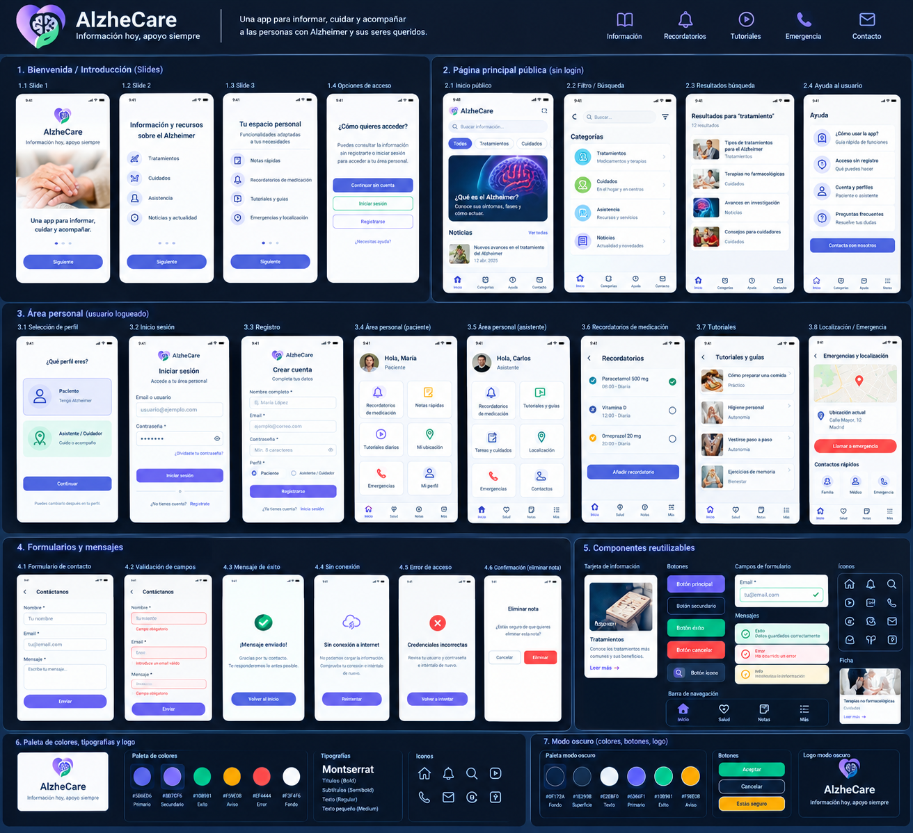
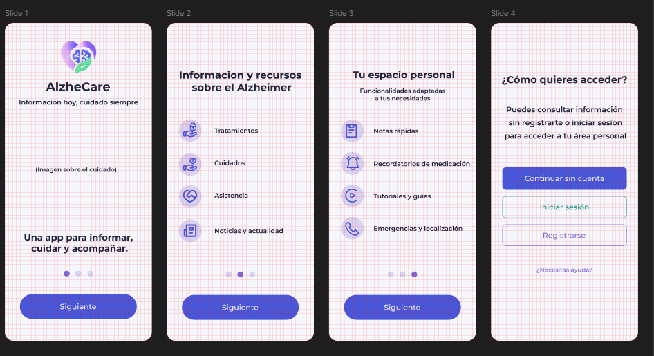
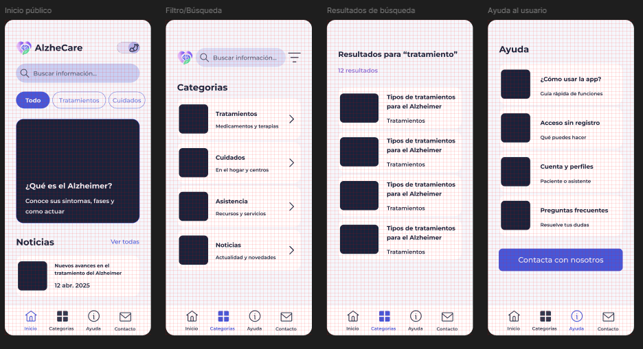
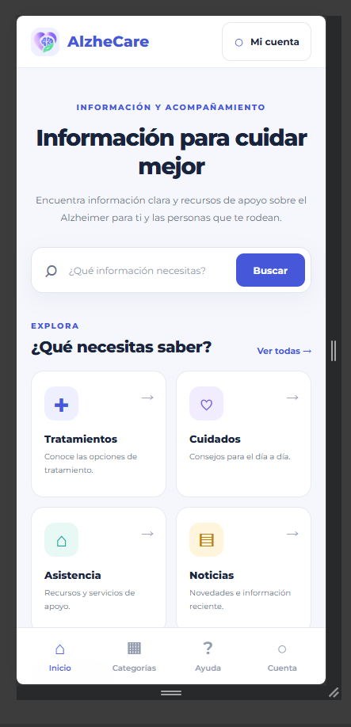
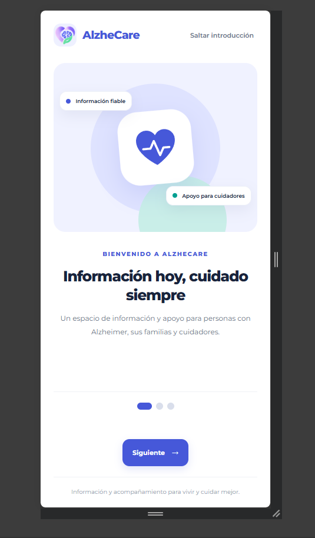
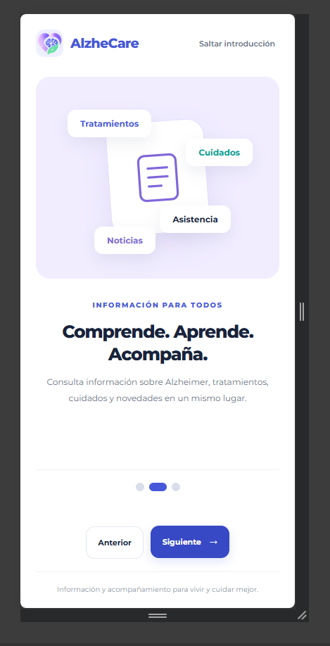
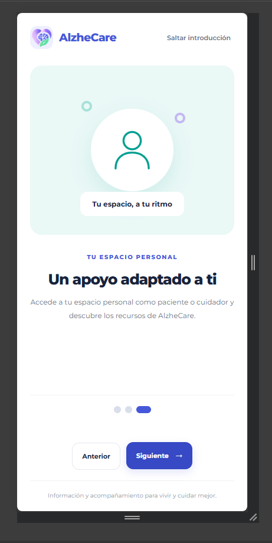
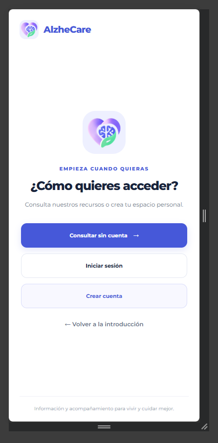
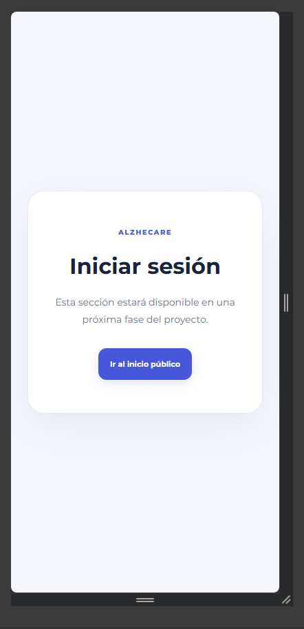
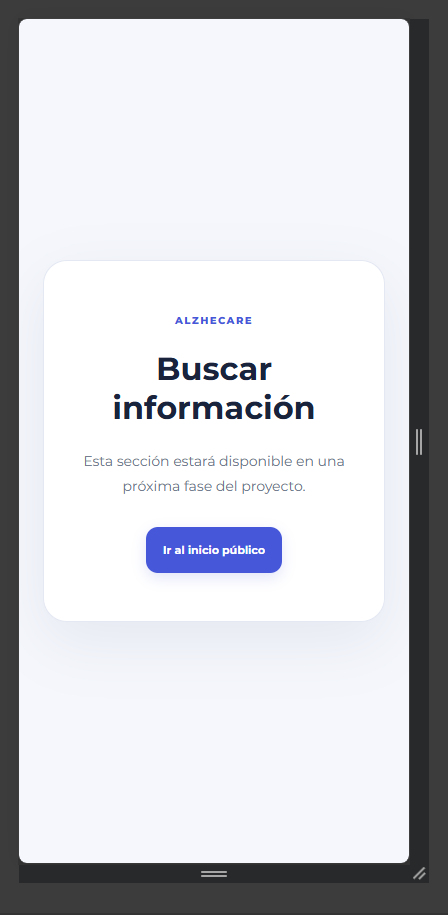

# AlzheCare – Primera entrega: Inicio y Navegación

Aplicación móvil orientada a proporcionar información y asistencia a personas con Alzheimer, sus familiares y cuidadores.

Esta primera entrega se centra en la construcción del frontend, el desarrollo de la página de inicio y la configuración del sistema de navegación entre las diferentes secciones de la aplicación.

---

## Table of Contents

1. [Información general](#información-general)
2. [Funcionalidades implementadas](#funcionalidades-implementadas)
3. [Tecnologías utilizadas](#tecnologías-utilizadas)
4. [Instalación y ejecución](#instalación-y-ejecución)
5. [Usabilidad y diseño](#usabilidad-y-diseño)
   - [Usabilidad actual](#usabilidad-actual)
   - [Accesibilidad](#accesibilidad)
   - [Aspecto visual](#aspecto-visual)
6. [Prototipado](#prototipado)
7. [Ejecutando las pruebas](#ejecutando-las-pruebas)
8. [Estado del proyecto y próximas entregas](#estado-del-proyecto-y-próximas-entregas)
9. [Colaboración](#colaboración)

---

## 1. Información general

AlzheCare es un proyecto de aplicación móvil diseñado para facilitar el acceso a información sobre la enfermedad de Alzheimer y ofrecer un espacio de apoyo a pacientes, familiares y cuidadores.

La aplicación se divide en dos áreas principales:

- **Área pública:** permite consultar información relacionada con el Alzheimer, sus cuidados, tratamientos, asistencia y noticias, sin necesidad de registrarse.
- **Área personal:** ofrecerá espacios diferenciados para pacientes y asistentes o cuidadores, accesibles mediante registro e inicio de sesión.

### Primera entrega: Inicio y Navegación

En esta primera fase se ha trabajado principalmente en la estructura visual del frontend y en la configuración de la navegación de la aplicación.

Los objetivos principales han sido:

- Crear el proyecto frontend utilizando React y Vite.
- Desarrollar la página de inicio de AlzheCare.
- Establecer una estructura inicial de componentes y páginas.
- Configurar la navegación mediante React Router.
- Definir una primera línea de diseño visual para la aplicación.
- Preparar la estructura para incorporar nuevas funcionalidades en futuras entregas.

**Estado del proyecto:** En desarrollo. Primera entrega centrada en el frontend, la página de inicio y la navegación.

---

## 2. Funcionalidades implementadas

En esta primera entrega se ha trabajado en los siguientes aspectos:

- **Página de inicio:** primera pantalla de presentación de AlzheCare, diseñada para introducir al usuario en la aplicación.
- **Navegación entre páginas:** configuración de rutas mediante React Router para facilitar el desplazamiento entre las diferentes secciones.
- **Estructura del frontend:** organización inicial del código en componentes reutilizables y páginas independientes.
- **Identidad visual:** aplicación de una primera propuesta de colores, tipografía y estilos.
- **Preparación para futuras funcionalidades:** estructura preparada para incorporar las áreas pública y personal, así como nuevas pantallas.

Las funcionalidades de autenticación, consulta dinámica de artículos, perfiles de usuario y conexión con el backend se desarrollarán en siguientes entregas.

---

## 3. Tecnologías utilizadas

Las principales tecnologías y herramientas utilizadas en esta primera entrega son:

- **[React](https://react.dev/)** – Biblioteca JavaScript utilizada para construir la interfaz de usuario mediante componentes.
- **[Vite](https://vite.dev/)** – Herramienta de desarrollo y construcción del frontend. Permite ejecutar el proyecto mediante un servidor local y ofrece recarga rápida durante el desarrollo.
- **[React Router](https://reactrouter.com/)** – Biblioteca utilizada para gestionar las rutas y la navegación entre las diferentes páginas de la aplicación sin necesidad de recargar completamente el sitio.
- **[JavaScript](https://developer.mozilla.org/es/docs/Web/JavaScript)** – Lenguaje utilizado para implementar la lógica de los componentes y la navegación.
- **[CSS](https://developer.mozilla.org/es/docs/Web/CSS)** – Utilizado para definir los estilos, la distribución de los elementos y la apariencia visual de la aplicación.
- **[Node.js](https://nodejs.org/)** – Entorno necesario para ejecutar las herramientas de desarrollo.
- **[npm](https://www.npmjs.com/)** – Gestor de paquetes utilizado para instalar las dependencias del proyecto.

*Nota: las versiones concretas de las dependencias pueden consultarse en el archivo `frontend/package.json`.*

---

## 4. Instalación y ejecución

Para ejecutar el frontend de AlzheCare en un entorno local, sigue los siguientes pasos.

### Requisitos previos

Antes de comenzar, es necesario disponer de:

- Node.js (versión 18 o superior recomendada).
- npm (incluido normalmente con Node.js).
- Git (opcional, si se desea clonar el repositorio).
- Un editor de código, como Visual Studio Code.

### 4.1. Clonar el repositorio

Clona el repositorio del proyecto:

```bash
git clone URL_DEL_REPOSITORIO
```

Accede a la carpeta del proyecto:

```bash
cd AlzheCare
```

### 4.2. Acceder al frontend

El frontend se encuentra dentro de la carpeta `frontend`:

```bash
cd frontend
```

### 4.3. Instalar las dependencias

Ejecuta el siguiente comando para instalar todas las dependencias definidas en `package.json`:

```bash
npm install
```

### 4.4. Ejecutar el servidor de desarrollo

Inicia el servidor local de Vite:

```bash
npm run dev
```

Una vez iniciado, Vite mostrará en la terminal una dirección local similar a la siguiente:

```text
http://localhost:5173/
```

Abre esa dirección en el navegador para visualizar la aplicación.

### 4.5. Detener la aplicación

Para detener el servidor de desarrollo, utiliza:

```bash
Ctrl + C
```

### Resumen de comandos

| Acción | Comando |
|---|---|
| Instalar dependencias | `npm install` |
| Ejecutar frontend | `npm run dev` |
| Generar versión de producción | `npm run build` |
| Previsualizar producción | `npm run preview` |

**Importante:** En esta primera entrega únicamente es necesario ejecutar el frontend. No se requiere configurar ni iniciar el backend o la base de datos para visualizar la interfaz y probar la navegación, siempre que las pantallas implementadas no dependan de servicios externos.

---

## 5. Usabilidad y diseño

AlzheCare está concebida para usuarios con diferentes necesidades y niveles de familiaridad con la tecnología. Por ello, desde las primeras fases se ha planteado una interfaz sencilla, intuitiva y accesible.

### Usabilidad actual

La página de inicio constituye el punto de entrada a la aplicación y debe permitir que cualquier usuario comprenda rápidamente su propósito y encuentre las opciones principales.

Se han establecido los siguientes criterios de diseño:

- Navegación clara y sencilla.
- Organización visual de los contenidos.
- Acceso intuitivo a las diferentes secciones.
- Distribución de elementos que facilite la lectura.
- Uso de componentes reutilizables para mantener la coherencia entre pantallas.

La navegación se gestiona mediante React Router, lo que permite cambiar de sección sin realizar una recarga completa de la aplicación.

### Accesibilidad

Dado que AlzheCare está dirigida también a personas con Alzheimer y a usuarios de edad avanzada, la accesibilidad es uno de los aspectos importantes del proyecto.

Se contemplan los siguientes criterios:

- Textos claros y fáciles de comprender.
- Tamaños de fuente adecuados para facilitar la lectura.
- Contraste suficiente entre texto y fondo.
- Botones y elementos interactivos fácilmente identificables.
- Navegación sencilla y consistente.
- Evitar la sobrecarga de información y los elementos visuales innecesarios.

Estos criterios servirán como referencia para el desarrollo de las siguientes pantallas.

### Aspecto visual

La identidad visual de AlzheCare sigue una estética sanitaria, moderna y cercana, evitando una interfaz excesivamente recargada.

La paleta de colores inicial es la siguiente:

| Elemento | Color | Uso |
|---|---|---|
| Primario | `#4658D9` | Botones principales y navegación activa |
| Secundario | `#8067D9` | Elementos destacados |
| Apoyo | `#009F91` | Acciones positivas y confirmaciones |
| Fondo | `#F5F7FC` | Fondo general |
| Texto principal | `#19233B` | Títulos y contenido |
| Éxito | `#16845B` | Confirmaciones |
| Advertencia | `#E6A11A` | Avisos preventivos |
| Error | `#D94343` | Errores y acciones destructivas |

La tipografía seleccionada es **Montserrat**, utilizada para mantener una apariencia uniforme y facilitar la lectura.

También se contempla la incorporación de un modo oscuro en la aplicación, que utilizará fondos azul oscuro, superficies diferenciadas y textos claros.

---

## 6. Prototipado

Durante esta primera entrega se ha trabajado en la materialización de la propuesta inicial de interfaz, tomando como referencia la estructura y las necesidades definidas para AlzheCare.

El prototipado permite comprobar la distribución de los elementos, la jerarquía visual y la facilidad de navegación antes de incorporar funcionalidades más complejas.







### Página de inicio



### Navegación

#### Bienvenida





#### Acciones de acceso



#### Opción inválida



#### Inicio público


#### Futura implementación



---

## 7. Ejecutando las pruebas

En esta primera entrega, las comprobaciones se centran principalmente en verificar que el frontend se ejecuta correctamente y que la navegación funciona según lo previsto.

### Comprobaciones realizadas

Se deben verificar los siguientes aspectos:

- La aplicación se inicia correctamente mediante `npm run dev`.
- La página de inicio se muestra sin errores.
- Las rutas configuradas mediante React Router funcionan correctamente.
- Los enlaces y botones de navegación conducen a las secciones correspondientes.
- La navegación entre páginas no provoca recargas completas.
- Los estilos y recursos visuales se cargan correctamente.
- La interfaz mantiene una distribución adecuada en diferentes tamaños de pantalla.
- No aparecen errores relevantes en la consola del navegador.

### Pruebas de navegación

Se comprobarán especialmente los siguientes comportamientos:

1. Acceder a la página de inicio.
2. Utilizar los elementos de navegación disponibles.
3. Acceder a las diferentes rutas implementadas.
4. Volver a la página de inicio.
5. Comprobar el comportamiento de la aplicación al acceder directamente a una ruta.

### Ejecución de pruebas

Para comprobar que el proyecto puede construirse correctamente, ejecuta:

```bash
npm run build
```

Este comando genera la versión optimizada de producción y permite detectar errores de compilación.

Para visualizar esa versión localmente:

```bash
npm run preview
```

*Si se incorporan herramientas de testing automatizado en futuras entregas, se documentarán aquí los comandos y resultados correspondientes.*

---

## 8. Estado del proyecto y próximas entregas

Esta primera entrega establece la base visual y estructural sobre la que se desarrollará el resto de AlzheCare.

### Completado en esta entrega

- Creación del frontend con React y Vite.
- Desarrollo de la página de inicio.
- Configuración de React Router.
- Organización inicial de páginas y componentes.
- Definición de la identidad visual inicial.

### Próximos objetivos

Las siguientes entregas ampliarán progresivamente las funcionalidades de la aplicación:

- Desarrollo del área pública y consulta de artículos informativos.
- Incorporación del buscador y filtros por categorías.
- Implementación del registro y del inicio de sesión.
- Desarrollo de las áreas personales para pacientes y cuidadores.
- Incorporación del modo oscuro.
- Implementación del formulario de contacto y sugerencias.
- Desarrollo del backend con Spring Boot.
- Configuración de la conexión con MariaDB.
- Integración del frontend con la API REST.
- Preparación de la aplicación móvil mediante Capacitor.

Las funcionalidades de recordatorios de medicación, tutoriales personalizados y localización quedan fuera del alcance de esta primera versión.

---

## 9. Desarrollo

El proyecto AlzheCare se desarrolla de forma personal de cara a un proyecto estudiantil. No se busca la contribución activa ni pasiva de terceros en el proyecto pero los consejos y recomendaciones seran todas bienvenidas.

---

**AlzheCare – Primera entrega: Inicio y Navegación**

*Construyendo una aplicación accesible para acompañar, informar y ayudar a personas con Alzheimer, sus familiares y cuidadores.*